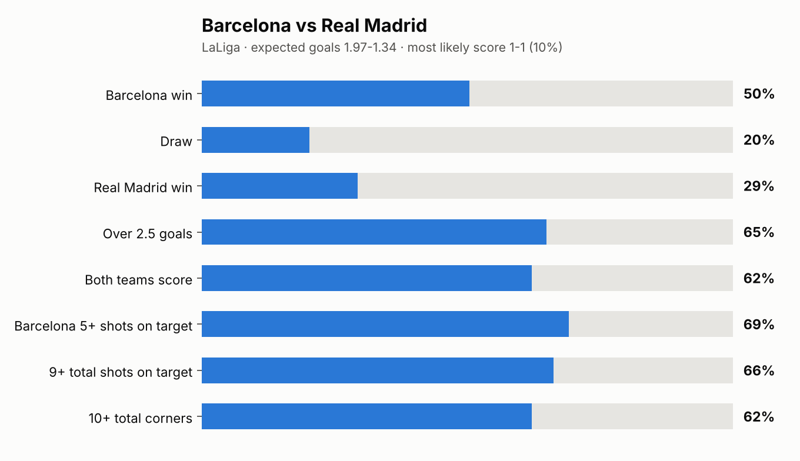
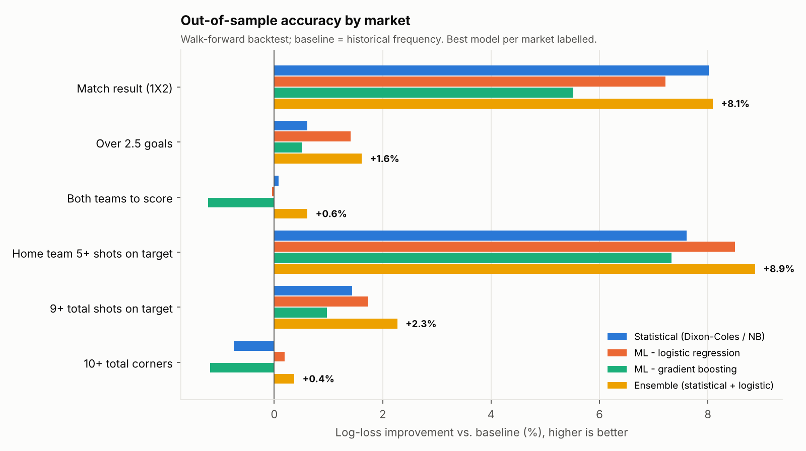
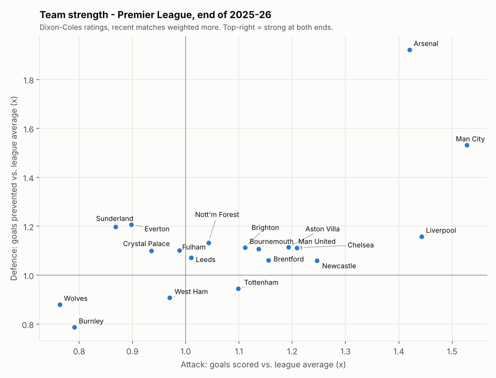
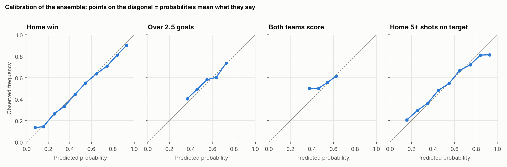
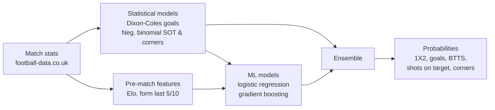

# Football Match Probabilities

[](https://github.com/santiagotolosa004-byte/football-match-probabilities/actions/workflows/tests.yml)


Probabilities for the questions people ask before a football match (**who wins, how many goals,
do both teams score, how many shots on target, how many corners**), built from public match
statistics with a statistical model, a machine-learning model and an ensemble of both.
Everything is evaluated **out-of-sample on 12,459 matches across Europe's top five leagues**.

```bash
python -m matchprob predict --league la-liga --home Barcelona --away "Real Madrid"
```



<details>
<summary>Full console output</summary>

```
Barcelona vs Real Madrid  (LaLiga, data up to 2026-05-24)
==================================================================
Blended probability (statistical model + machine learning)
  Barcelona win                  50.4%
  Draw                           20.2%
  Real Madrid win                29.4%
  Over 2.5 goals                 64.9%
  Both teams score               62.2%
  Barcelona 5+ shots on target   69.2%
  9+ total shots on target       66.2%
  10+ total corners              62.1%

Statistical model details
  Expected goals                1.97 - 1.34
  Expected shots on target      5.9 - 4.5
  Expected corners              6.3 - 4.8
  Total goals                   o0.5 96%  o1.5 84%  o2.5 64%  o3.5 42%  o4.5 24%
  Barcelona clean sheet          26.2%
  Real Madrid clean sheet        14.0%
  Most likely scores            1-1 (10%), 2-1 (9%), 1-0 (7%), 2-0 (7%), 1-2 (6%)
```
</details>

## Why I built this

I'm passionate about football and have played it my whole life. As I grew up and started studying data
science, I realised I could combine what I was learning with what I love most. I've been a **FC Barcelona**
fan since I was a baby, and I've always used analytics to follow the team: reading the stats, comparing
performances and trying to understand why a match went the way it did.

This project is the natural next step. Instead of only reading the numbers, I wanted to build models that turn
them into probabilities for the questions every fan asks before kick-off, and then test honestly how often
those probabilities are right.

---

## Results

Walk-forward backtest, seasons 2019-20 to 2025-26. Every prediction was made using only data available
before kick-off. The numbers below show the ensemble's log-loss improvement over a baseline that always predicts
the historical frequency (higher is better).

| League | Matches | 1X2 RPS (stat → ensemble) | 1X2 | Over 2.5 | BTTS | Home 5+ SOT | 9+ SOT | 10+ corners |
|---|---|---|---|---|---|---|---|---|
| Premier League | 2,660 | 0.2033 → 0.2029 | +8.1% | +1.6% | +0.6% | +8.9% | +2.3% | +0.4% |
| LaLiga | 2,660 | 0.1988 → 0.1978 | +7.6% | +2.3% | +0.4% | +8.9% | +4.4% | +1.9% |
| Serie A | 2,660 | 0.1971 → 0.1958 | +9.8% | +1.0% | +0.2% | +11.3% | +6.3% | +3.0% |
| Bundesliga | 2,142 | 0.2057 → 0.2034 | +7.5% | +2.0% | +0.7% | +7.1% | +2.5% | +0.6% |
| Ligue 1 | 2,337 | 0.2088 → 0.2082 | +6.5% | +1.3% | -0.1% | +6.6% | +4.0% | -0.3% |

**What I learned from it**

* **The ensemble was the best of the four models in all 30 league × market combinations**, and beat the
  baseline in 28 of 30. Averaging a structured statistical model with a regularised ML model reduces
  the errors of each.
* **Some questions are much more predictable than others.** Who wins and how many shots on target a team
  gets are well predicted (+7-11%). Total goals and "both teams score" are close to a coin flip once you
  know the league average (+0-2%). That is a real property of football, not a bug.
* **More complex is not better.** Gradient boosting lost to plain logistic regression in 29 of 30 cases:
  with a few thousand matches of history, the flexible model overfits.
* **The probabilities are mostly well calibrated.** For match results and shots on target, when the model says
  60% it happens about 60% of the time. The weak spot is "both teams score" at low probabilities: matches
  rated ~40% happened ~50% of the time (see the calibration chart below).

<p float="left">
  
  
</p>



Full Premier League report: [`docs/sample_output/report.md`](docs/sample_output/report.md).

---

## Data

Match statistics from **[football-data.co.uk](https://www.football-data.co.uk/)**, the standard free source
for historical football data: results, shots, shots on target, corners, fouls and cards for every match.
The project covers the Premier League, LaLiga, Serie A, Bundesliga and Ligue 1 from 2010-11.

* `--source github` (default): a public mirror of those files ([datasets/football-datasets](https://github.com/datasets/football-datasets)),
  with completed seasons only.
* `--source football-data`: the original site. It also includes the **season in progress** and **betting
  odds**, which the backtest then uses as an extra benchmark ("bookmaker" column).

Files are downloaded once and cached in `data/`.

## How it works



### 1. Statistical models (team strength)

Each team gets an **attack** and a **defence** rating, plus a league-wide home advantage:

```
log E[home goals] = μ + home_advantage + attack[home] + defence[away]
log E[away goals] = μ                  + attack[away] + defence[home]
```

* **Goals: Dixon-Coles model (1997).** Poisson goals plus a correction for low scores (0-0, 1-0, 0-1, 1-1),
  which independent Poisson gets wrong. The result is a full matrix of score probabilities. Every goal
  market is derived from that one matrix (1X2, over/under 0.5-4.5, both teams to score, clean sheets,
  most likely scores), so they are all consistent with each other.
* **Shots on target and corners: negative binomial.** The same structure, but these counts are more
  spread out than Poisson allows, so a dispersion parameter is estimated (variance = μ + α·μ²).
* **Recent matches weigh more:** weight = exp(-0.0019 × days ago), a half-life of about one year.
  A small L2 penalty keeps promoted teams with little data close to league average.
* Fitted by weighted maximum likelihood with analytic gradients (SciPy L-BFGS). One fit takes about 7 ms.

### 2. Machine-learning layer

* **Features**, all computed only from earlier matches: Elo ratings, and each team's average over the last 5 and
  10 matches of points, goals, shots, shots on target and corners (for and against), plus the statistical
  model's own probabilities and expected goals (stacking).
* **Models:** L2-regularised logistic regression, and gradient boosting (scikit-learn).
* **Ensemble:** the average of the statistical model and the logistic regression.

### 3. Honest evaluation

* **Walk-forward:** the statistical models are refitted every week using only the previous 3 years. The ML
  models are retrained every season using only earlier seasons. Nothing from the future leaks into a
  prediction, and a test proves it (`tests/test_no_leakage.py`).
* **Proper scoring rules:** log loss, Brier score and **RPS** (ranked probability score, the standard for
  home/draw/away because it knows a draw is closer to a home win than an away win is), plus calibration.

## Quick start

```bash
git clone https://github.com/santiagotolosa004-byte/football-match-probabilities.git
cd football-match-probabilities
python -m venv .venv && source .venv/bin/activate      # Windows: .venv\Scripts\activate
pip install -r requirements.txt

python -m matchprob teams    --league la-liga                       # team names as written in the data
python -m matchprob predict  --league la-liga --home "Real Madrid" --away Barcelona
python -m matchprob backtest --league serie-a                       # report + charts in output/
python -m matchprob backtest --source football-data                 # adds the bookmaker benchmark

pytest
```

Leagues: `premier-league`, `la-liga`, `serie-a`, `bundesliga`, `ligue-1`. Team names are matched loosely
(`"man city"`, `"Forest"`).

## Project structure

```
matchprob/
  data.py       download + cache + normalise football-data.co.uk files (dates, columns, odds)
  models.py     Dixon-Coles goal model, negative-binomial count model
  markets.py    score matrix / distributions -> 1X2, over/under, BTTS, shots on target, corners
  features.py   Elo and rolling form, strictly pre-match
  backtest.py   weekly walk-forward of the statistical models
  ml.py         logistic regression, gradient boosting, ensemble, season-by-season evaluation
  metrics.py    log loss, Brier, RPS, calibration
  pipeline.py   backtest / predict orchestration, team-name matching
  report.py     charts and markdown report
tests/          25 tests on simulated leagues with known team strengths (no internet needed)
```

## Testing

* **The models recover the truth.** On simulated leagues with known attack/defence ratings, the fitted ratings
  correlate above 0.9 with the true ones, and the home advantage and dispersion parameters are recovered.
* **There is no look-ahead.** Future results are scrambled and the test checks that earlier features and
  predictions do not change at all.
* **The markets are consistent.** Home + draw + away = 1, BTTS matches a brute-force calculation, over-lines
  are monotonic, and bookmaker margins are removed correctly.
* **Data parsing** is tested on both CSV formats (ISO and dd/mm/yy dates, odds columns, unplayed fixtures).
* **CI** runs on Python 3.11-3.13 on every push.

## Limitations and next steps

* **Team-level stats only.** Player-level shots on target (e.g. "will Haaland have 2+ shots on target")
  need player data such as FBref. That is the next extension.
* No line-ups, injuries or expected-goals (xG) data. Adding xG would likely improve the goal markets most.
* A small Streamlit app to pick any fixture from a dropdown.

> These are probabilities, not certainties, and this is a data-analytics project, not betting advice.

---

**Santiago Tolosa Torres** · Data Science & Mathematics Engineering (Finance & Economics concentration),
Tecnológico de Monterrey · [LinkedIn](https://www.linkedin.com/in/santiagotolosa)
