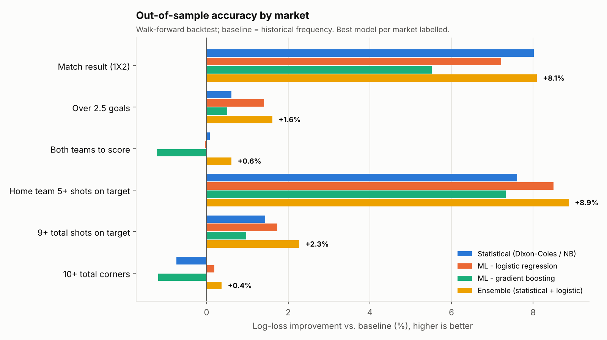
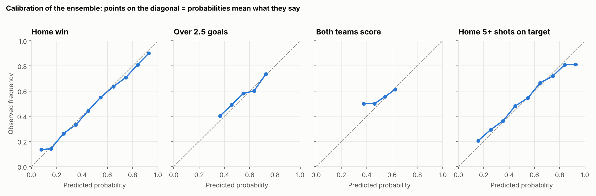
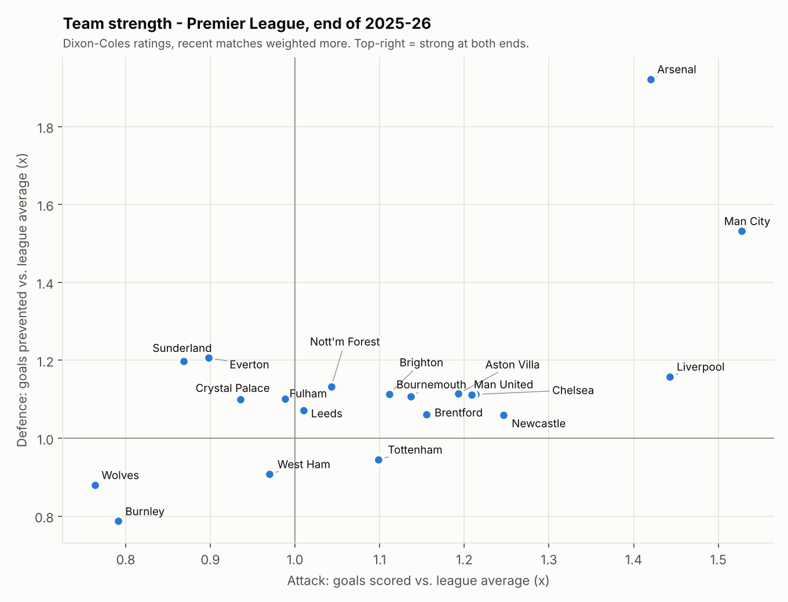

# Backtest report - Premier League

- Data: 6,080 matches, seasons 2010-2026 (football-data.co.uk)
- Scored out-of-sample on **2,660 matches**, seasons 2019-20 to 2025-26
- Statistical models refitted every week on the previous 3 years; ML models retrained every season on previous seasons only

## Log loss by market (lower is better; best model in bold)

| Market | Baseline | Statistical | ML logistic | ML boosting | Ensemble |
|---|---|---|---|---|---|
| Match result (1X2) | 1.0703 | 0.9845 | 0.9931 | 1.0112 | **0.9837** |
| Over 2.5 goals | 0.6895 | 0.6853 | 0.6798 | 0.6859 | **0.6783** |
| Both teams to score | 0.6923 | 0.6918 | 0.6926 | 0.7008 | **0.6881** |
| Home team 5+ shots on target | 0.6937 | 0.6409 | 0.6348 | 0.6429 | **0.6322** |
| 9+ total shots on target | 0.6940 | 0.6841 | 0.6820 | 0.6873 | **0.6783** |
| 10+ total corners | 0.6826 | 0.6876 | 0.6813 | 0.6907 | **0.6801** |

## Match result (1X2)

| Model | RPS | Brier | Accuracy |
|---|---|---|---|
| Baseline | 0.2337 | 0.6481 | 43.4% |
| Statistical (Dixon-Coles / NB) | 0.2033 | 0.5854 | 53.3% |
| ML - logistic regression | 0.2048 | 0.5904 | 52.6% |
| ML - gradient boosting | 0.2079 | 0.6010 | 52.1% |
| Ensemble (statistical + logistic) | 0.2029 | 0.5849 | 53.3% |

